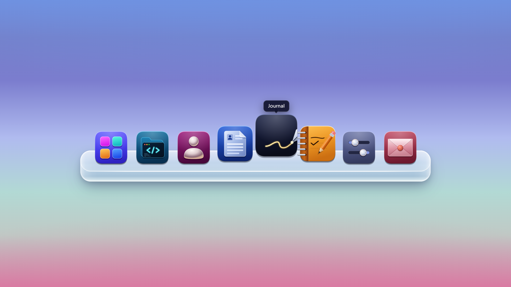

# 3D Frosted Glass Dock



An interactive, macOS-inspired 3D frosted glass dock component built with React 19, TypeScript, and Tailwind CSS. Published on [21st.dev/@ainunnajib2006/components/3d-frosted-glass-dock](https://21st.dev/@ainunnajib2006/components/3d-frosted-glass-dock).

## Quick Install (21st.dev)

```bash
npx 21st add @ainunnajib2006/3d-frosted-glass-dock
```

## Highlights

- **Physics Simulation**: Uses custom Euler spring calculations with continuous velocity for smooth magnification.
- **Direct GPU Transforms**: Applies transforms directly to DOM elements inside `requestAnimationFrame` to avoid React re-renders during pointer movement.
- **Glassmorphic Shelf**: Features specular highlights, frosted acrylic styling, and inverted reflections.
- **Custom Vector Graphics**: Includes handcrafted squircle icons with ambient depth.
- **Keyboard & Accessibility**: Supports number keys 1-8, Escape key, Tab focus states, and respects reduced motion preferences.
- **Modular Component**: Accepts custom `items` with your own icons and actions.

## Quick Start

```bash
bun install
bun run dev
```

Visit `http://localhost:3000` to view the dock in your browser.

## Customization Examples

### 1. Default Dock with Built-in 3D Skeuomorphic Icons

```tsx
import { GlassDock } from '@/components/GlassDock';

export default function App() {
  return <GlassDock />;
}
```

### 2. Custom Items with Your Own Icons (Lucide / SVG / Image)

```tsx
import { GlassDock } from '@/components/GlassDock';
import { Home, Compass, FolderGit2, Settings } from 'lucide-react';

const myItems = [
  { id: 'home', label: 'Home', icon: <Home className="w-6 h-6" />, onClick: () => alert('Home clicked!') },
  { id: 'explore', label: 'Explore', icon: <Compass className="w-6 h-6" />, href: 'https://github.com' },
  { id: 'projects', label: 'Projects', icon: <FolderGit2 className="w-6 h-6" /> },
  { id: 'settings', label: 'Settings', icon: <Settings className="w-6 h-6" /> },
];

export default function App() {
  return (
    <GlassDock
      items={myItems}
      settings={{ magnification: 1.4, maxLift: 20 }}
      showTooltips={true}
      showReflections={true}
    />
  );
}
```

## Component Props

| Prop | Type | Default | Description |
| :--- | :--- | :--- | :--- |
| `items` | `DockAppItem[]` | `DOCK_APPS` | Custom dock items (`id`, `label`, `icon`, `onClick`, `href`) |
| `settings` | `Partial<DockSettings>` | `DEFAULT_DOCK_SETTINGS` | Physics parameters (`magnification`, `influenceRadius`, `maxLift`, `reflectionOpacity`, `enableBounce`) |
| `activeAppId` | `string \| null` | `null` | Currently active/focused item ID |
| `runningApps` | `Set<string>` | `undefined` | Set of item IDs displaying active indicator dots |
| `onSelectApp` | `(id: string) => void` | `undefined` | Callback fired on icon selection |
| `className` | `string` | `""` | Additional Tailwind classes for container positioning |
| `showTooltips` | `boolean` | `true` | Toggle floating tooltips on hover |
| `showReflections` | `boolean` | `true` | Toggle inverted specular shelf reflections |

## Scripts

- `bun run dev` - Start development server
- `bun run build` - Create production bundle
- `bun run lint` - Run TypeScript validation
- `bun test` - Run physics unit tests
